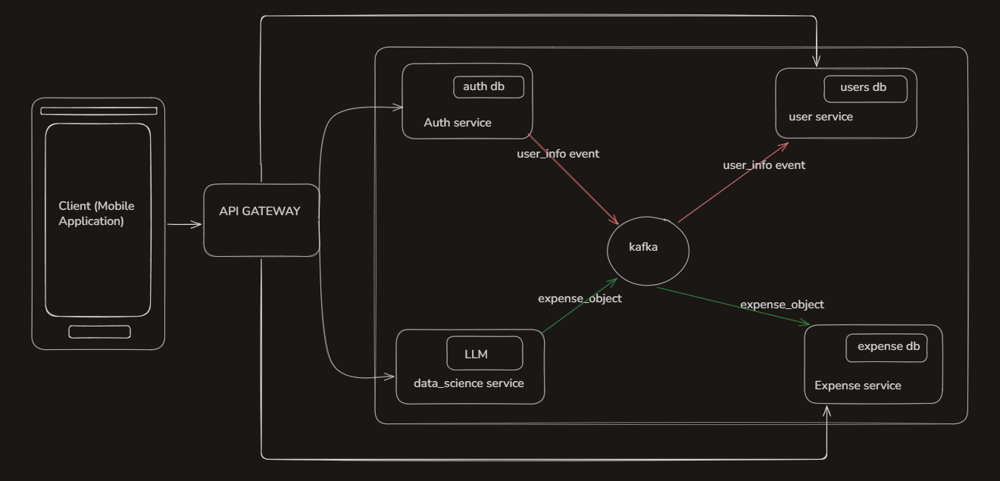
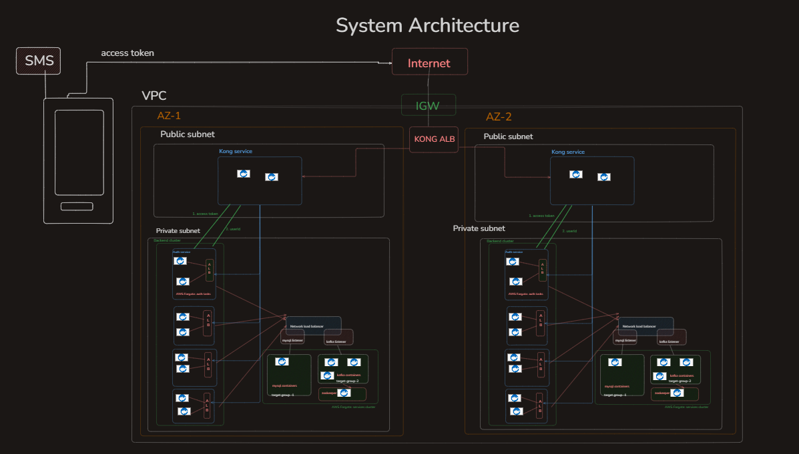
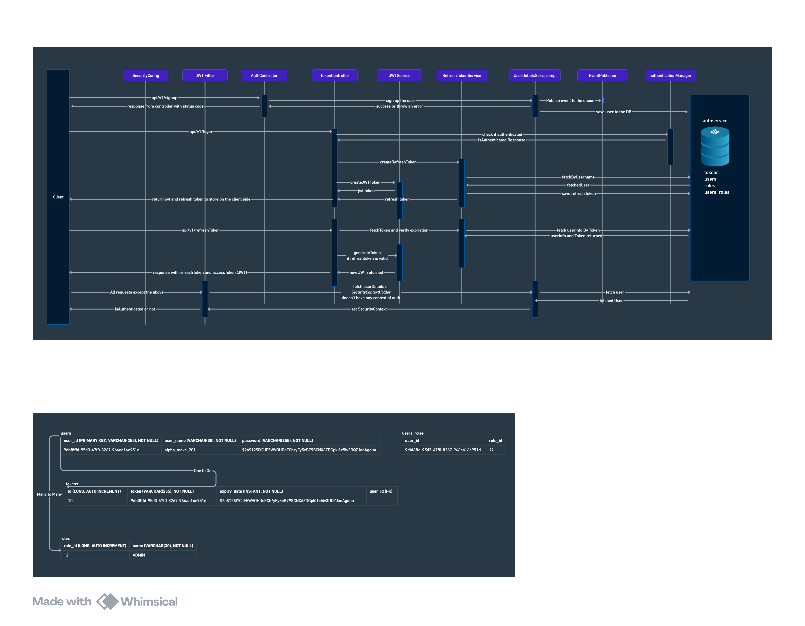
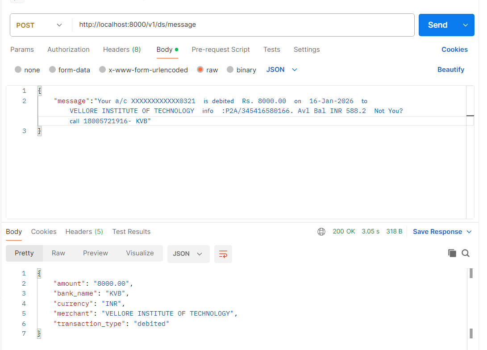

# Automated-SMS-Expense-Tracker
An automated expense management platform that extracts financial transactions from bank SMS messages, converts them into structured expense records, and provides centralized expense tracking.
Tracks transactions made across UPI apps in common place using bank SMS messages. This helps in user not to juggle between apps whether money has been received or not.
 
This is built using java spring boot as backend framework and microservices architecture. Kafka is used for inter microservice communication. Entire infrastructure is deployed on aws following scalable, highly available and secure principles using aws cdk. frontend is react native mobile application. Database used is MySQL.

# Architecture

## Data Flow

## System Architecture

# Technology Stack

Backend: Java, Spring Boot

Frontend: React Native

Database: MySQL

Messaging: Apache Kafka (inter microservices), HTTP (Client - Server)

API Gateway: Kong

Infrastructure: AWS, Docker, AWS CDK

Authentication: JWT (Access & Refresh Tokens)

 
# Backend Microservices 

## 1. Authentication Microservice 

### Github : https://github.com/Rohithgvmg/expense_tracker_authservice

Handles authentication and authorization of users using JWT access and refresh tokens. 

## 2. User Microservice

Stores User data related to profile , allowing auth service to only save auth related data and perform auth operations only.
Whenever signup happens, the events are pushed to kafka from auth service, kafka sends to user service, which stores user details in the user service database. 

### Github : https://github.com/Rohithgvmg/expense_tracker_userservice

## 3. Data science Microservice

We send SMS from banks to this service (which uses LLM) and returns structured response 

The response object is stored in ledger service inside expense servcie.

Below is request response image:

### Github : https://github.com/Rohithgvmg/datascience_service

## 4. Expense Microservice

Expense Microservice stores the expense records received from data science service through kafka. Database used is MySQL

### Github: https://github.com/Rohithgvmg/expense_tracker_expenseservice 

# Frontend Application

React native mobile application 

### Github : https://github.com/Rohithgvmg/expense_tracker-frontend

# Infrastructure 

Entire deployment is done using AWS CDK (Cloud development Kit) code creating network stack , kafka and MySQL stack and Microservices stack.

### Github: https://github.com/Rohithgvmg/expense_tracker_awsCDK 

# API Gateway 

Kong serves API Gateway particularl for routing requests to different microservices without frontend needing to know different service addresses. API Gateway is placed in public subnet so that it can be accessed and also ensures every requests route through auth service first.

### Github : https://github.com/Rohithgvmg/expense_tracker_kong

